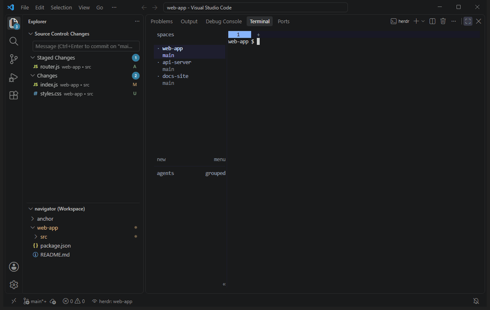

# Herdr Navigator

Keeps VS Code's Explorer and Source Control on the folder of the pane you have focused in [herdr](https://herdr.dev).

## Features

- Follows the focused herdr pane's folder when you change space, tab or pane, or `cd` in it.
- Snaps to the Git repository root, so moving between subfolders of one repository changes nothing.
- Shows one repository at a time in Source Control, or an Initialize offer when the space has no Git.
- Relaunches herdr when VS Code restores the window, and returns herdr's panes to their folders after a herdr restart.
- Needs no configuration on Windows, macOS or Linux.

## Requirements

- VS Code 1.142 or newer, in a local window (Remote and untrusted workspaces are not supported).
- [herdr](https://herdr.dev/docs/install/) 0.9.5 or newer.

## Quick start

1. Search for "Herdr Navigator" in the Extensions view, or run `code --install-extension z3nder.herdr-navigator`.
2. Start herdr in VS Code's integrated terminal.
3. Focus another herdr pane. The window follows its folder; the first switch reloads the window once.

Click the herdr status bar item to toggle auto-follow, or run "Herdr: Follow Focused Pane Now" (`Ctrl+K Ctrl+Alt+H`, `Cmd+K Cmd+Alt+H` on macOS).

## Settings

- `herdrNavigator.autoFollow`: follow herdr focus changes automatically (default on).
- `herdrNavigator.followGitRoot`: follow the Git repository root instead of the exact folder (default on).

All settings and commands are listed on the Features tab of the extension's page in VS Code's Extensions view.

## More

- [User guide](https://github.com/ZenderX/herdr-vscode-navigator/blob/main/docs/user-guide.md): Source Control behaviour, the optional herdr plugin, known limitations, troubleshooting and privacy.
- [Changelog](https://github.com/ZenderX/herdr-vscode-navigator/blob/main/CHANGELOG.md)
- [Issue tracker](https://github.com/ZenderX/herdr-vscode-navigator/issues)

## License

MIT. See [LICENSE](https://github.com/ZenderX/herdr-vscode-navigator/blob/main/LICENSE).
